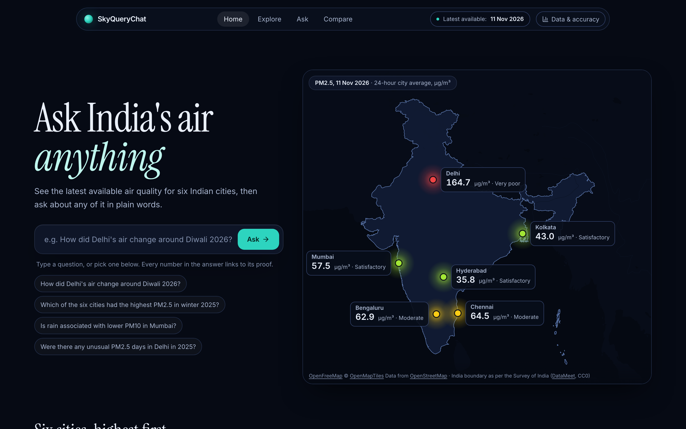
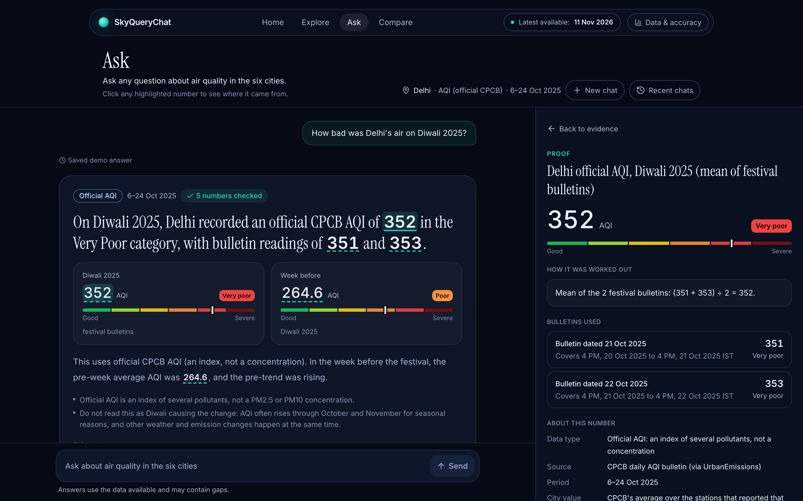
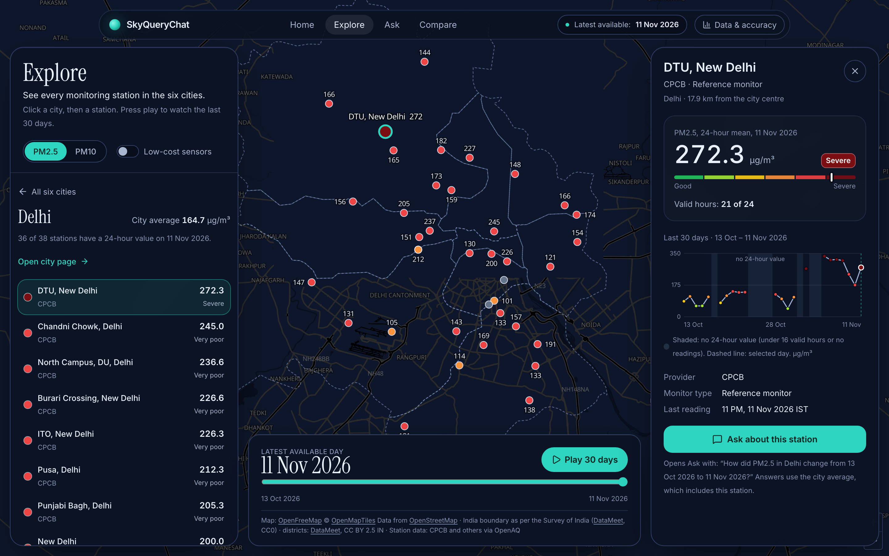
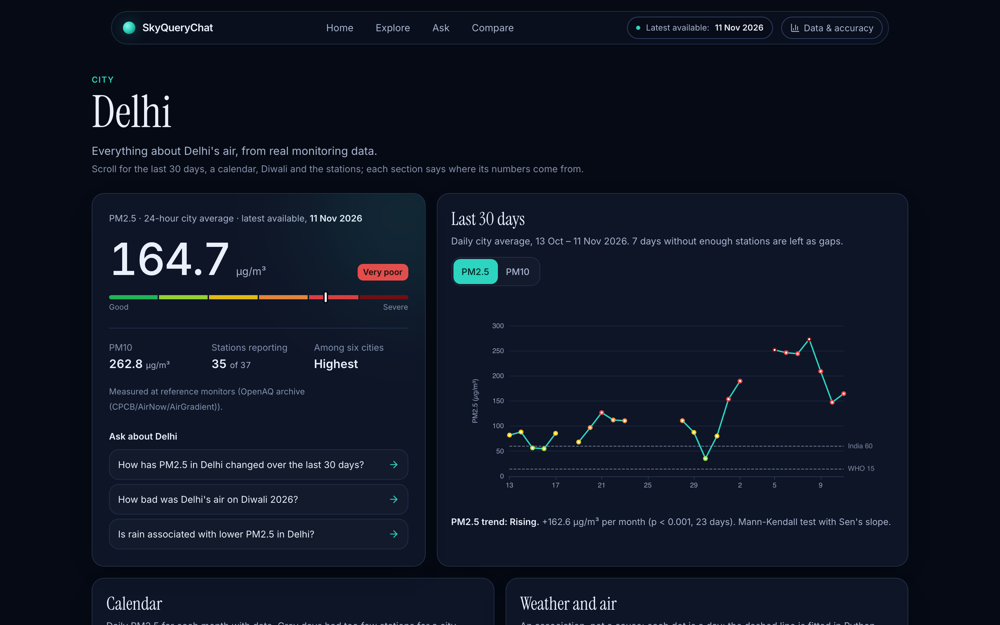
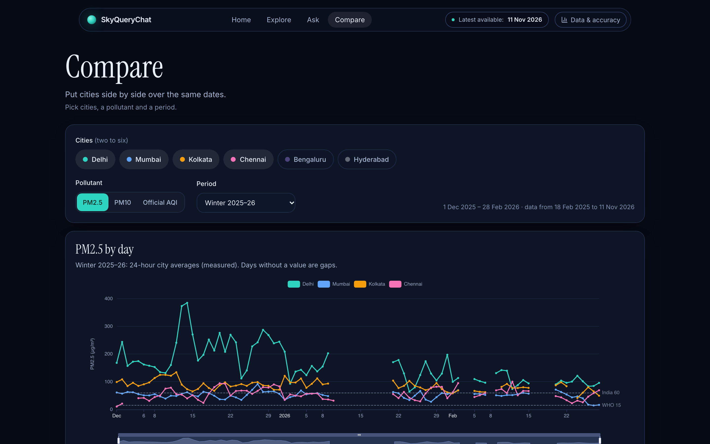
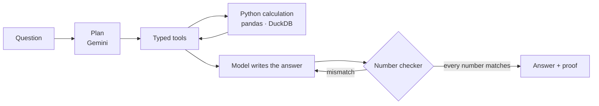

# SkyQueryChat

**An AI air-quality analyst for six Indian cities that shows the proof behind every number.**

**Live:** https://sky-query-chat.vercel.app · Delhi, Mumbai, Kolkata, Chennai, Bengaluru and Hyderabad · PM2.5, PM10 and official AQI



| Ask, with proof | Explore | City page | Compare |
|---|---|---|---|
|  |  |  |  |

## Features

- **Home:** the latest available 24-hour PM2.5 for each city on a map of India, ranked, with a 7-day sparkline.
- **Ask:** type a question in plain words. The answer comes with a chart, an evidence table and the agent's steps.
  Click any highlighted number to see where it came from: the rows or bulletins used, the formula, the source and
  the check.
- **Explore:** every monitoring station on a map, with 30 days of daily values, a play button and a station panel.
  Low-cost sensors are shown separately.
- **City pages** (`/city/delhi` and the other five cities):
  - the latest value and a 30-day trend with significance
  - a calendar heatmap and Diwali AQI from CPCB's 4 PM bulletins
  - unusual days with the reason each was flagged
  - a weather association with a fitted line, and every station with its coverage
- **Compare:** 2–6 cities over the same dates, for PM2.5, PM10 or official AQI:
  - daily lines and a ranking with 95% range bars
  - "too close to call" when the ranges overlap
  - a trend for each city and a warning when coverage is low
  - the selection is kept in the link
- **Data & accuracy panel:** sources and licences, coverage, the latest date, first-pass test scores, the CPCB
  cross-check and known limits.

## How the agent works

1. The model reads the question and plans which typed tools to call (resolve the city, the dates and the event;
   then trend, comparison, Diwali, unusual days or weather).
2. Python runs every calculation: city averages from valid station-days, Mann-Kendall trends with Sen's slope,
   weekly block-bootstrap 95% ranges and Spearman correlations.
3. Tools return compact named fields, never raw tables. The model may only copy numbers from those fields.
4. A number checker matches every number and date in the answer against the tool results. A mismatch, causal
   wording or trend wording that contradicts the trend test goes back to the model to fix.
5. The page builds the cards, the chart and the proof for each number from the same results, and streams each step
   live over Server-Sent Events.



## Data and honesty rules

- **Real data only.** Values are never invented or interpolated between stations. Gaps stay as gaps, and the site
  says "latest available", never "live".
- **Separate metrics.** Measured PM, official AQI (an index) and modelled weather are kept apart, and AQI and PM
  never share a chart.
- **Associations, not causes.** Weather results are worded as associations, and Diwali results describe timing only.
- **Delhi Diwali PM** for 2024 and 2025 comes from a source that blanks values above 999 µg/m³. It is shown only as
  supporting context, as a lower bound, and never as a percentage change.
- **Coverage is always visible.** Every result states its stations and coverage. A comparison uses only the days on
  which every selected city has a value.

## Evaluation (first-pass scores)

Each score is one complete run of a whole question set, scored against reference values computed separately in
plain pandas and scipy. Reruns are kept apart and never replace these numbers.

| Set | Questions | First pass | Numbers traced to data | Run date | Answer wording |
|---|---|---:|---:|---|---|
| Main | trends, comparisons, Diwali, weather, unusual days, trick questions | **47 / 51** | 100% | 5 Nov 2026 | earlier wording |
| Unseen (holdout 2) | never used for tuning | **10 / 11** | 100% | 6 Nov 2026 | earlier wording |
| First unseen (retired) | used once | **11 / 11** | 100% | 5 Nov 2026 | earlier wording |
| Diwali 2026 | festival bulletins and caveats | **9 / 9** | 100% | 12 Nov 2026 | earlier wording |
| Statistics | 95% ranges, too close to call, trends, weather | **8 / 8** | 100% | 13 Nov 2026 | current wording |

The current wording (readable dates, caveats kept in the answer) dates from 13 Nov 2026. The statistics set is new:
its first complete run scored 5/8, and one failure showed a real problem (an answer said "no clear trend" when the test
said "not enough data"). A trend-wording check was added, and the second complete run, shown above, scored 8/8.
The other sets have not been re-run in full with the current wording yet (the free daily quota is shared with
visitors). Runs are in `evals/runs/`,
and the scoreboard is `evals/scoreboard.json`.

## Tech stack

- **Frontend:** Next.js 16, TypeScript, Tailwind CSS 4, shadcn/ui, Apache ECharts, MapLibre GL and Framer Motion.
  Hosted on Vercel.
- **Backend:** Python 3.13, FastAPI with Server-Sent Events, pandas, DuckDB and Parquet. Hosted on Render (free,
  512 MB).
- **Agent:** Pydantic AI with Gemini 3.5 Flash-Lite, falling back to Gemini 3.1 Flash Lite and then Gemini 3.8
  Flash. One shared quota limiter serves all visitors.
- **Tests:**
  - 269 backend tests
  - 61 frontend unit tests
  - 77 Playwright tests (including axe accessibility checks)
  - live evaluation sets (above)

## Run locally

```bash
python3 -m venv .venv && source .venv/bin/activate
pip install -r requirements-dev.txt
cp .env.example .env                       # add your own GEMINI_API_KEY to .env
uvicorn backend.api.main:app --port 8000

cd frontend
cp .env.example .env.local                 # NEXT_PUBLIC_API_BASE_URL=http://localhost:8000
npm install && npm run dev                 # http://localhost:3000
```

Tests:
- **Backend:** `pytest`
- **Frontend unit tests:** `cd frontend && npm test`
- **End-to-end:** `npm run e2e`, which starts both servers
- **Live evaluation:** `python scripts/run_eval.py --set main`, run through the shared quota limiter

Rebuild the data with `python scripts/build_dataset.py`, `python scripts/fetch_weather.py` and
`python scripts/derive_app_tables.py`. Only `data/app/` (about 3 MB) is deployed.

## Deploy

- **Backend (Render):** create a Blueprint from this repository; `render.yaml` sets the build, Python version, health
  check and variables. Add `GEMINI_API_KEY` and `ALLOWED_ORIGINS` (the Vercel address) in the dashboard.
- **Frontend (Vercel):** use root directory `frontend` and set `NEXT_PUBLIC_API_BASE_URL` to the Render address.
- **Production limits:** each visitor gets 4 questions a minute and 30 a day. The free backend sleeps when idle; the
  site shows a wake-up message for about a minute.

## Limits

- Free-tier AI quota is shared by all visitors. When it runs out, the Ask page says so, and Explore, the city pages
  and Compare still work (they use no AI).
- About 30% of city-days have network-wide gaps in the OpenAQ archive. Those days are labelled, and they are left out
  of weather associations.
- Station sets differ from CPCB's own city averages, so our PM-only AQI estimate is a data check only, never shown as
  AQI.
- The number checker verifies numbers and dates, not the meaning of every sentence.

## Credits and licences

- **Measured PM:** [OpenAQ](https://openaq.org) archive (CPCB, AirNow and AirGradient data); the licence is set by
  each data provider.
- **Official AQI:** CPCB daily bulletins, via [UrbanEmissions](https://github.com/urbanemissionsinfo/AQI_bulletins)
  and [cpcb.gov.in](https://cpcb.gov.in/AQI_Bulletin.php) (GODL-India).
- **Delhi station files:** [OpenCity](https://data.opencity.in) (public domain).
- **Weather:** [Open-Meteo.com](https://open-meteo.com) (CC BY 4.0), reanalysis from the Copernicus Climate Change
  Service.
- **Maps:** [OpenFreeMap](https://openfreemap.org) with OpenStreetMap data (ODbL). The India boundary as per the
  Survey of India comes from [DataMeet](https://github.com/datameet/maps) (CC0); the Census 2011 districts are also
  from DataMeet (CC BY 2.5 IN).
