<div align="center">



<br>

[](https://sky-query-chat.vercel.app)        

**[🌐 Live site](https://sky-query-chat.vercel.app)** · **[🤖 How it works](#how-the-agent-works)** · **[📊 Evaluation](#evaluation)** · **[🚀 Run locally](#run-locally)**

<br>

<b>Ask India's air anything.</b> SkyQueryChat is an agentic AI analyst for six Indian cities, plus the official AQI for every<br>
city in CPCB's daily bulletin. It answers in plain words, and <b>every number links to the data it came from</b>.

</div>

<br>



<br>



## ✨ What you can do

<table>
<tr>
<td width="33%" valign="top"><h3>🏠 Home</h3>Latest PM2.5 for six metros on an India map, and a search over every CPCB bulletin city.</td>
<td width="33%" valign="top"><h3>💬 Ask</h3>Plain-language questions; answers with a chart, evidence and a proof behind every number.</td>
<td width="33%" valign="top"><h3>🗺️ Explore</h3>Every monitoring station on a map, with 30 days you can play back.</td>
</tr>
<tr>
<td width="33%" valign="top"><h3>🏙️ City pages</h3>Trend with significance, calendar heatmap, Diwali AQI, unusual days and weather links.</td>
<td width="33%" valign="top"><h3>⚖️ Compare</h3>2–6 cities over the same dates, with 95% ranges and “too close to call”.</td>
<td width="33%" valign="top"><h3>🔬 Data &amp; accuracy</h3>Sources, coverage, test scores and known limits in one panel.</td>
</tr>
</table>

<details>
<summary><b>Every feature, in detail</b></summary>
<br>

<details>
<summary><b>Home</b>: the latest available PM2.5 for six cities on a map of India</summary>

- Cities ranked highest first, each with a 7-day sparkline.
- The change from the previous day ("▲ 17.3 vs 10 Nov"), shown only when that day has a value.
- CPCB's official health statement for the category, on hover or focus.
- **Find your city:** search all 329 cities in CPCB's daily bulletin (older names such as Bangalore or Gurgaon work);
  choosing one opens its official AQI panel on Explore.
- Quick ask from any page: ⌘K or Ctrl+K.
</details>

<details>
<summary><b>Explore</b>: every monitoring station on a map, with 30 days of daily values</summary>

- A slim timeline with a mini chart of the daily averages and a Diwali marker; play the last 30 days at 1× or 2×.
- Search any station by name across the six cities.
- A station panel with its 30-day chart and CPCB's health statement. Low-cost sensors are shown separately.
- **All CPCB cities (official AQI):** a second layer with every bulletin city as a small dot coloured by category (the
  six metros highlighted), a searchable list, and a city panel with the latest AQI, main pollutant, change from the
  previous bulletin, a 30-day chart with gaps and "Ask about this city". Locations from GeoNames; a city without a
  confident match is listed but not plotted.
</details>

<details>
<summary><b>Ask</b>: plain-language questions, with a proof for every number</summary>

- Each answer comes with a chart, an evidence table and the agent's steps.
- Click a highlighted number to see where it came from.
- Copy a link that reopens the question, copy the answer, and download the chart (PNG) or its data (CSV).
- Any city in CPCB's bulletin can be asked about ("AQI in Lucknow"): the answer uses the official AQI and says that
  station-level PM analysis covers only the six cities. A place outside the bulletin gets an honest answer with the
  nearest covered cities.
</details>

<details>
<summary><b>City pages</b>: everything about one city's air, from real monitoring data</summary>

- The latest value, the change from the previous day and a 30-day trend with significance.
- A calendar heatmap, Diwali AQI from CPCB's 4 PM bulletins, and unusual days with the reason each was flagged.
- A weather association with a fitted line, and every station with its coverage.
- Copy link and download data (CSV).
</details>

<details>
<summary><b>Compare</b>: 2–6 cities side by side over the same dates</summary>

- A slim control panel on the left and the results on the right: a summary strip (highest city, lowest city and their
  ratio, or "too close to call"), then the chart and the ranking.
- PM2.5, PM10 or official AQI (AQI on its own chart), with daily lines and a ranking with 95% range bars.
- "Too close to call" when ranges overlap, a trend for each city, and a warning when coverage is low.
- The selection is kept in the link; copy link and download data (CSV).
</details>

<details>
<summary><b>Data & accuracy</b>: sources, coverage, test scores and known limits in one panel</summary>

- Sources and licences, including the map credits and CPCB's health statements.
- The latest available date, cities and stations, and first-pass evaluation scores.
- How the number checker works, the CPCB cross-check and the known limits.
</details>
</details>

<a id="how-the-agent-works"></a>

<br>



<details>
<summary><b>The agent, step by step</b></summary>
<br>

1. The model reads the question and plans which typed tools to call (resolve the city, the dates and the event;
   then trend, comparison, Diwali, unusual days or weather).
2. Python runs every calculation: city averages from valid station-days, Mann-Kendall trends with Sen's slope,
   weekly block-bootstrap 95% ranges and Spearman correlations.
3. Tools return compact named fields, never raw tables. The model may only copy numbers from those fields.
4. A number checker matches every number and date in the answer against the tool results. A mismatch, causal
   wording or trend wording that contradicts the trend test goes back to the model to fix.
5. The page builds the cards, the chart and the proof for each number from the same results, and streams each step
   live over Server-Sent Events.
</details>

<br>



<a id="evaluation"></a>

<br>



<details>
<summary><b>How the evaluation works</b></summary>
<br>

First-pass scores are one complete run of a whole question set, scored against reference values computed separately in
plain pandas and scipy. Reruns are kept apart.

The current answer wording dates from 16 Nov 2026 (comparison answers lead with the higher city, difference, ratio and
period). In the latest runs, Gemini wrote every headline except one in the statistics set, where the checked
code-written fallback was used (8.3% of answered turns; 0% in the conversation set). Earlier first runs of the same two
sets (10/12 and 12/14) stay on record in `evals/runs/`.
Evaluations run on a frozen copy of the data (`evals/data/`, to 11 Nov 2026), so scores stay reproducible while the site's
data refreshes daily. Runs are in `evals/runs/`; the scoreboard is
`evals/scoreboard.json`.
</details>

For the full architecture, data, agent, methods and results, see the [project overview](docs/project-overview.md).

## 🧭 Data and honesty rules

- Real data only: nothing is invented or interpolated between stations, and gaps stay as gaps.
- Measured PM, official AQI (an index) and modelled weather are kept apart; AQI and PM never share a chart.
- Weather results are associations, and Diwali results describe timing only.
- Delhi Diwali PM for 2024 and 2025 is a lower bound (the source blanks values above 999 µg/m³) and never a percentage.
- Every result states its stations and coverage; comparisons use only days where every city has a value.

## 🧰 Tech stack

| Layer | Tools |
|---|---|
| Frontend | Next.js 16, TypeScript, Tailwind CSS 4, shadcn/ui, Apache ECharts, MapLibre GL, Framer Motion (Vercel) |
| Backend | Python 3.13, FastAPI with Server-Sent Events, pandas, DuckDB, Parquet (Render) |
| Agent | Pydantic AI with Gemini 3.5 Flash-Lite, then 3.1 Flash Lite and 3.8 Flash; one shared quota limiter |
| Tests | 317 backend tests, 73 frontend unit tests, 120 Playwright tests (104 run, 16 size-specific skips) with axe accessibility checks (zero serious or critical issues), all on 16 Nov 2026 |

<a id="run-locally"></a>

## 🚀 Run locally

```bash
python3 -m venv .venv && source .venv/bin/activate      # Windows: .venv\Scripts\activate
pip install -r requirements-dev.txt
cp .env.example .env                 # add your own GEMINI_API_KEY
uvicorn backend.api.main:app --port 8000

cd frontend && cp .env.example .env.local && npm install && npm run dev   # http://localhost:3000
```

Tests: `pytest`, then `npm test` and `npm run e2e` in `frontend/`. Deploy: see [DEPLOY.md](DEPLOY.md) (Render for the
backend, Vercel with root directory `frontend` for the site).

Rebuild only the all-cities official AQI table (the daily refresh does this too):
`python scripts/build_city_aqi_all.py`; city locations: `python -I scripts/build_city_coordinates.py <GeoNames IN.zip>`.

## ⚠️ Limits

- The free AI quota is shared by all visitors; when it runs out, Ask says so, and Explore, the city pages and Compare
  still work.
- About 30% of city-days have network-wide gaps in the OpenAQ archive; they are labelled and left out of weather
  associations.
- The number checker verifies numbers and dates, not the meaning of every sentence.

## 📜 Credits and licences

- **Measured PM:** [OpenAQ](https://openaq.org) archive (CPCB, AirNow and AirGradient); licence set by each provider.
- **Official AQI:** CPCB daily bulletins via [UrbanEmissions](https://github.com/urbanemissionsinfo/AQI_bulletins) and
  [cpcb.gov.in](https://cpcb.gov.in/AQI_Bulletin.php) (GODL-India), for the six cities and for every bulletin city.
  **City locations:** [GeoNames](https://www.geonames.org) (CC BY 4.0). **Delhi station files:**
  [OpenCity](https://data.opencity.in) (public domain).
- **Weather:** [Open-Meteo.com](https://open-meteo.com) (CC BY 4.0), reanalysis from the Copernicus Climate Change
  Service.
- **Maps:** [OpenFreeMap](https://openfreemap.org) with OpenStreetMap data (ODbL); the boundary of India as per the
  Survey of India and the Census 2011 districts from [DataMeet](https://github.com/datameet/maps) (CC0; CC BY 2.5 IN).
