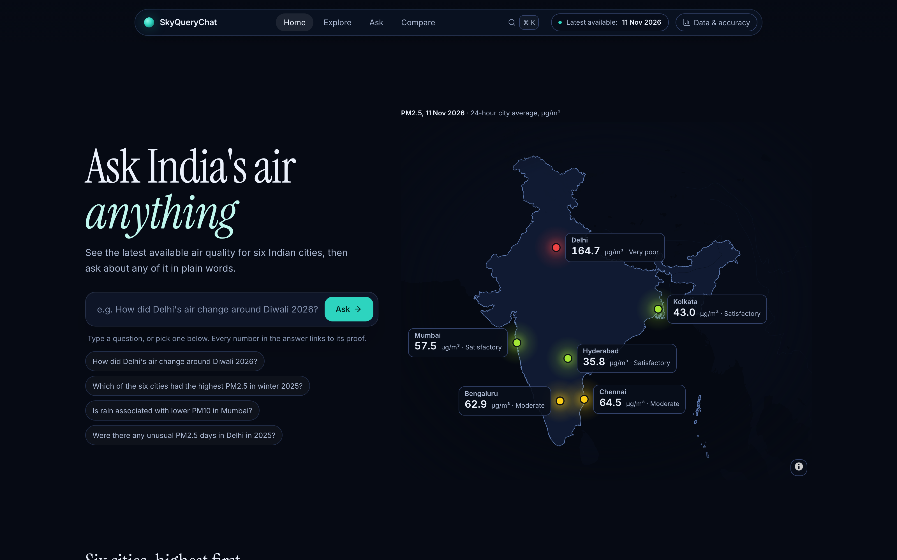
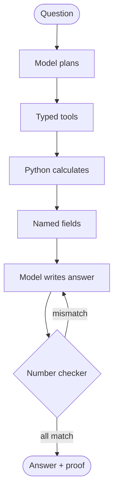

<div align="center">



<br>

[](https://sky-query-chat.vercel.app)        

**[Live site](https://sky-query-chat.vercel.app)** · **[How it works](#how-the-agent-works)** · **[Evaluation](#evaluation)**

</div>

<br>

<p align="center">
  
  <br>
  <sub>Home: the latest available 24-hour PM2.5 for Delhi, Mumbai, Kolkata, Chennai, Bengaluru and Hyderabad.</sub>
</p>

## Why it's different

<table>
<tr>
<td width="50%" valign="top">

### 🔎 Proof for every number
Click any number in an answer to see the rows or bulletins it came from, the formula and the source. A checker
matches every number and date against the analysis before an answer is shown.

</td>
<td width="50%" valign="top">

### 🤖 A real agent with tools
The model plans and calls typed tools; Python does every calculation. Wrong numbers, causal wording or a plan instead
of an answer are sent back to the model to fix.

</td>
</tr>
<tr>
<td width="50%" valign="top">

### 📊 Honest statistics
Mann-Kendall trends with Sen's slope, 95% ranges from a weekly block bootstrap, and "too close to call" when cities
overlap. Weather results are associations, never causes.

</td>
<td width="50%" valign="top">

### 🗺️ An official India map
The boundary of India as per the Survey of India, real monitoring stations only, gaps kept as gaps, and no values
drawn between stations.

</td>
</tr>
</table>

## Features

<details>
<summary><b>Home</b>: the latest available PM2.5 for six cities on a map of India</summary>

- Cities ranked highest first, each with a 7-day sparkline.
- The change from the previous day ("▲ 17.3 vs 10 Nov"), shown only when that day has a value.
- CPCB's official health statement for the category, on hover or focus.
- Quick ask from any page: ⌘K or Ctrl+K.
</details>

<details>
<summary><b>Explore</b>: every monitoring station on a map, with 30 days of daily values</summary>

- A slim timeline with a mini chart of the daily averages and a Diwali marker; play the last 30 days at 1× or 2×.
- Search any station by name across the six cities.
- A station panel with its 30-day chart and CPCB's health statement. Low-cost sensors are shown separately.
</details>

<details>
<summary><b>Ask</b>: plain-language questions, with a proof for every number</summary>

- Each answer comes with a chart, an evidence table and the agent's steps.
- Click a highlighted number to see where it came from.
- Copy a link that reopens the question, copy the answer, and download the chart (PNG) or its data (CSV).
</details>

<details>
<summary><b>City pages</b>: everything about one city's air, from real monitoring data</summary>

- The latest value, the change from the previous day and a 30-day trend with significance.
- A calendar heatmap, Diwali AQI from CPCB's 4 PM bulletins, and unusual days with the reason each was flagged.
- A weather association with a fitted line, and every station with its coverage.
- Copy link and download data (CSV).
</details>

<details>
<summary><b>Compare</b>: 2–6 cities side by side over the same dates</summary>

- PM2.5, PM10 or official AQI (AQI on its own chart), with daily lines and a ranking with 95% range bars.
- "Too close to call" when ranges overlap, a trend for each city, and a warning when coverage is low.
- The selection is kept in the link; copy link and download data (CSV).
</details>

<details>
<summary><b>Data & accuracy</b>: sources, coverage, test scores and known limits in one panel</summary>

- Sources and licences, including the map credits and CPCB's health statements.
- The latest available date, cities and stations, and first-pass evaluation scores.
- How the number checker works, the CPCB cross-check and the known limits.
</details>

## How the agent works

1. The model reads the question and plans which typed tools to call (resolve the city, the dates and the event;
   then trend, comparison, Diwali, unusual days or weather).
2. Python runs every calculation: city averages from valid station-days, Mann-Kendall trends with Sen's slope,
   weekly block-bootstrap 95% ranges and Spearman correlations.
3. Tools return compact named fields, never raw tables. The model may only copy numbers from those fields.
4. A number checker matches every number and date in the answer against the tool results. A mismatch, causal
   wording or trend wording that contradicts the trend test goes back to the model to fix.
5. The page builds the cards, the chart and the proof for each number from the same results, and streams each step
   live over Server-Sent Events.



## Evaluation

First-pass scores: one complete run of a whole question set, scored against reference values computed separately in
plain pandas and scipy. Reruns are kept apart.

| Set | First pass | Numbers traced | Run date | Wording |
|---|---:|---:|---|---|
| Main (51 questions) | **47 / 51** | 100% | 14 Nov 2026 | current |
| Unseen (holdout 2) | **11 / 11** | 100% | 13 Nov 2026 | current |
| First unseen (retired) | **11 / 11** | 100% | 5 Nov 2026 | earlier |
| Diwali 2026 | **9 / 9** | 100% | 14 Nov 2026 | current |
| Statistics | **8 / 8** \* | 100% | 13 Nov 2026 | current |

\* After fixing a trend-wording bug found in a first run of 5/8. The current answer wording dates from 13 Nov 2026.
Evaluations run on a frozen copy of the data (`evals/data/`, to 11 Nov 2026), so scores stay reproducible while the site's
data refreshes daily. Runs are in `evals/runs/`; the scoreboard is
`evals/scoreboard.json`.

## Data and honesty rules

- Real data only: nothing is invented or interpolated between stations, and gaps stay as gaps.
- Measured PM, official AQI (an index) and modelled weather are kept apart; AQI and PM never share a chart.
- Weather results are associations, and Diwali results describe timing only.
- Delhi Diwali PM for 2024 and 2025 is a lower bound (the source blanks values above 999 µg/m³) and never a percentage.
- Every result states its stations and coverage; comparisons use only days where every city has a value.

## Tech stack

| Layer | Tools |
|---|---|
| Frontend | Next.js 16, TypeScript, Tailwind CSS 4, shadcn/ui, Apache ECharts, MapLibre GL, Framer Motion (Vercel) |
| Backend | Python 3.13, FastAPI with Server-Sent Events, pandas, DuckDB, Parquet (Render) |
| Agent | Pydantic AI with Gemini 3.5 Flash-Lite, then 3.1 Flash Lite and 3.8 Flash; one shared quota limiter |
| Tests | 285 backend tests, 68 frontend unit tests, 120 Playwright tests (104 run, 16 size-specific skips) with axe accessibility checks |

## Run locally

```bash
python3 -m venv .venv && source .venv/bin/activate
pip install -r requirements-dev.txt
cp .env.example .env                 # add your own GEMINI_API_KEY
uvicorn backend.api.main:app --port 8000

cd frontend && cp .env.example .env.local && npm install && npm run dev   # http://localhost:3000
```

Tests: `pytest`, then `npm test` and `npm run e2e` in `frontend/`. Deploy: `render.yaml` for the backend, and Vercel
with root directory `frontend` for the site.

## Limits

- The free AI quota is shared by all visitors; when it runs out, Ask says so, and Explore, the city pages and Compare
  still work.
- About 30% of city-days have network-wide gaps in the OpenAQ archive; they are labelled and left out of weather
  associations.
- The number checker verifies numbers and dates, not the meaning of every sentence.

## Credits and licences

- **Measured PM:** [OpenAQ](https://openaq.org) archive (CPCB, AirNow and AirGradient); licence set by each provider.
- **Official AQI:** CPCB daily bulletins via [UrbanEmissions](https://github.com/urbanemissionsinfo/AQI_bulletins) and
  [cpcb.gov.in](https://cpcb.gov.in/AQI_Bulletin.php) (GODL-India). **Delhi station files:**
  [OpenCity](https://data.opencity.in) (public domain).
- **Weather:** [Open-Meteo.com](https://open-meteo.com) (CC BY 4.0), reanalysis from the Copernicus Climate Change
  Service.
- **Maps:** [OpenFreeMap](https://openfreemap.org) with OpenStreetMap data (ODbL); the boundary of India as per the
  Survey of India and the Census 2011 districts from [DataMeet](https://github.com/datameet/maps) (CC0; CC BY 2.5 IN).
