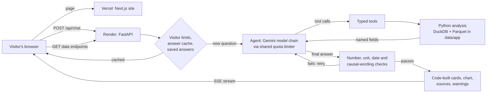

# SkyQueryChat: project overview

Status as of 16 Nov 2026 (evening). Every figure below is read from the repository (configuration, data manifests, the evaluation
scoreboard and test runs). Live site: <https://sky-query-chat.vercel.app>.

## 1. Summary

SkyQueryChat is a web app for asking plain-language questions about particulate pollution (PM2.5 and PM10) and official
air-quality index (AQI) values in six Indian cities: Delhi, Mumbai, Kolkata, Chennai, Bengaluru and Hyderabad. It is meant
for students, journalists and anyone who wants checked numbers without handling raw monitoring data. A language model
writes the wording, Python calculates every number from stored measurements, and a checker confirms each number before
an answer is shown, with its source, stations and coverage.

## 2. Architecture

| Part | What it is | Where it runs |
|---|---|---|
| Frontend | Next.js site (`frontend/`): Home, Explore, Ask, City, Compare and the Data & accuracy panel | Vercel (Hobby) |
| Backend | FastAPI app (`backend/api/`): read-only data endpoints and a streaming chat endpoint (Server-Sent Events) | Render free web service, Singapore |
| Analysis | Python functions over compact Parquet tables queried with DuckDB (`backend/analysis/`) | inside the backend |
| AI agent | Pydantic AI agent with typed tools, a number checker and a shared quota limiter (`backend/agent/`) | inside the backend |
| Data pipeline | Download, cleaning and table building (`backend/pipeline/`, `scripts/`) | locally and in GitHub Actions; never on Render |

The browser calls the backend directly, so per-visitor limits see each visitor's address. Data endpoints never call the
language model, so they keep working when the AI quota is used up.

## 3. Data

| Source | What it provides | Type | Coverage in the app |
|---|---|---|---|
| OpenAQ S3 archive, plus the OpenAQ API for days the archive has not yet published | Hourly PM2.5 and PM10 from CPCB reference stations (and some low-cost sensors, kept in a separate tier) | Measured | 18 Feb 2025 to 15 Nov 2026 (archive to 10 Nov, API for later days) |
| CPCB daily AQI bulletins (UrbanEmissions' parsed table, then CPCB's own PDFs for later dates) | Official city AQI, category and prominent pollutant, 4 PM to 4 PM | Official AQI | to 15 Nov 2026 |
| Open-Meteo Historical Weather API (Copernicus C3S reanalysis) | Daily temperature, humidity, wind and rain per city | Modelled | 18 Feb 2025 to 15 Nov 2026 |
| OpenCity (CPCB data) | Delhi PM around Diwali 2024 and 2025 | Measured, supporting only | fixed files; values above 999 µg/m³ are blank |

Stations in the app tables: Delhi 37 primary reference stations, Mumbai 22, Hyderabad 9, Kolkata 7, Chennai 6 and
Bengaluru 6 (87 in total), plus 15 low-cost sensors and 9 supporting single stations kept out of city averages. The app
tables in `data/app` are about 3.3 MB.

**Cleaning and validation rules** (`backend/pipeline/transform.py`, `quality.py`, `derive.py`):

- Values of 0 or below and above 5,000 µg/m³ are removed and counted; values above 1,000 are kept and flagged.
- Timestamps mark the end of each reading; hours are placed by the interval start in Indian Standard Time.
- A station-day counts only with at least 16 valid hours. A city value is the equal-weight mean of valid station-days
  and needs at least max(3, half) of the primary stations.
- Flat-lines (6 or more identical hours) and isolated spikes that nearby stations do not show are excluded from analysis
  values (supported spikes, such as verified Diwali nights, are kept). Station-days where PM2.5 exceeds PM10 by more than
  max(20%, 20 µg/m³) are excluded. Peer-outlier station-days are flagged only.
- Missing data is never filled in. Hours when much of the station network is silent are recorded as gaps, and each
  city-date gets a quality level (none, minor, moderate, severe).

**Daily refresh:** `.github/workflows/refresh-data.yml` (02:00 UTC daily, plus manual runs, 30-minute job limit) runs
`scripts/refresh_data.py`. The build is incremental: it continues from the committed `data/processed` tables and
downloads only the days from their OpenAQ archive end, so it never fetches the full history and needs no file that exists
only on a local machine (the Delhi OpenCity results come from a small committed cache). It then checks that end dates
never move back, that published values do not change and that `data/app` stays under 8 MB, runs the backend tests, and
commits "Refresh data through <date>" only when data changed (build times alone do not count). A source that cannot be
reached keeps its previous data and is reported as a warning. First green run: 16 Nov 2026, 11.6 minutes in total (7.7
for the refresh and checks, 3 for the tests), committing "Refresh data through 15 Nov 2026".

## 4. AI agent

**Models** (`backend/config/models.json`): `gemini-3.5-flash-lite` first, then `gemini-3.1-flash-lite`, then
`gemini-3.8-flash`, through one Google API key. A model that fails (rate limit, missing model, rejected key, server error
or a request longer than 20 seconds) is skipped and the next one is tried. A Groq `openai/gpt-oss-120b` entry is kept but
disabled.

**Reply types:** the model chooses a kind in its single final answer: greeting, about (the project), knowledge
(air-quality facts), data, clarify, or off-topic (a fixed polite refusal, also used for attempts to change or reveal the
instructions). Non-data replies use no tools and may only quote numbers from `backend/config/knowledge.json` (CPCB
categories, breakpoints and health statements, glossary, sources, limits) or the data dates.

**Data questions:** the model writes a one-line plan, then calls typed tools (`city_trend`, `compare_cities`,
`diwali_aqi`, `delhi_pm_diwali`, `unusual_days`, `weather_association`, `data_coverage`, `check_request`). Code resolves
cities, pollutants and periods; tools return named fields only, never raw tables. Python computes every value. The model
writes the headline, a short explanation and follow-up questions; code builds the metric cards, chart, sources, the
comparison card and required warnings from the tool results.

**Checker and self-correction** (`backend/agent/verify.py`, `core.py`): every number and readable date in the answer
must match a tool value at the precision written; a count must carry the unit of its field (for example, days are not
written as cities); causal wording ("due to", "caused") is rejected in favour of "associated with"; trend wording must
agree with the trend test; quoting the instructions is rejected. A failed answer goes back to the model with the reasons
(up to 3 retries). If every attempt fails, or the token cap stops the run after the data was computed, a code-written
lead sentence from the same results is shown and marked as such.

**Limits** (`backend/agent/quota.py`, `backend/api/`): one shared limiter per model counts requests and tokens for all
visitors, with caps at 80% of the provider limits and 15% of daily capacity reserved for the owner's demo. Each question
may use at most 12,000 tokens and 60 seconds. Visitors are limited to 4 questions a minute and 30 a day. Repeated
questions are served from a 6-hour answer cache, and a set of saved demo answers works without the model. Counters live
in memory, so they reset when Render restarts the service.

## 5. Analysis methods

| Method | How it is calculated |
|---|---|
| Averages | Mean and median of valid daily city values; comparisons use only days on which every city has a value |
| Trend | Mann-Kendall test with tie correction and Sen's slope over real time; a direction is stated only when p < 0.05, "not enough data" below 20 valid days; under 90 days it is reported as the total change over the period |
| 95% ranges | Block bootstrap of daily values in whole 7-day blocks with a fixed seed; neighbouring cities whose ranges overlap by at least half are "too close to call" |
| Comparisons | Difference and ratio of the common-day means, from unrounded values |
| Weather | Spearman correlation with a Fisher-z 95% range, plus Theil-Sen line for the scatter chart; severe-gap days excluded; always an association |
| Unusual days | Each day compared with the median of the surrounding 15-day window (excluding itself); unusual when the difference exceeds 3 × a robust spread (1.4826 × median absolute deviation) |
| AQI categories | CPCB National AQI bands (Good 0–50 to Severe 401–500); official AQI comes only from bulletins. A PM-only AQI estimate is used internally as a cross-check and never shown as AQI |

The statistics are written with numpy only (`backend/analysis/stats.py`); tests check them against scipy.

## 6. Website

| Page | Main features |
|---|---|
| Home | Official India outline map with the six cities, ranked city cards with the latest available PM2.5, 7-day sparkline, day-over-day change and the official AQI chip for the same date |
| Explore | Map of every station with data in the latest 30 days, day slider with playback, PM2.5/PM10 switch, low-cost sensor switch, station list and panel; phone bottom sheet |
| Ask | Chat with live agent steps, answers with clickable numbers that open their proof, comparison card, key numbers, chart (weekly/daily views over 90 days), evidence and data tabs, follow-up chips, recent chats stored in the browser |
| City (`/city/[slug]`) | Six city pages: latest PM2.5 and PM10 with stations reporting, official AQI, rank among the six, 30-day trend, a daily calendar, Diwali official AQI and recent unusual days |
| Compare | Two or more cities on matching dates: daily lines, ranking with 95% ranges, trends; PM2.5, PM10 or AQI; period presets |
| Data & accuracy panel | First-pass evaluation scores, "Check our numbers" (link to CPCB bulletins, cross-check figures), glossary of short terms, sources and credits |

## 7. Tech stack

| Layer | Tools | Purpose |
|---|---|---|
| Frontend | Next.js 16.4.5, React 19.3.0, TypeScript 5, Tailwind CSS 4, shadcn/ui (Base UI 1.9), Apache ECharts 6, MapLibre GL 6.16, Framer Motion 14.7 | Pages, charts, maps, motion |
| Backend | Python 3.13.15, FastAPI 0.162, Uvicorn 0.54, pandas 3.1, PyArrow 26, DuckDB 2.0, httpx 0.28 | API, data access, streaming |
| Agent | Pydantic AI 2.66 (Google provider), Gemini models listed above | Tool calling, structured answers |
| Tests | pytest, Vitest 5, Playwright 1.65 with axe-core 4.11 | Backend, unit, browser and accessibility tests |
| Hosting | Vercel, Render, GitHub Actions | Site, API, daily data refresh |

## 8. Quality

**Tests** (run 16 Nov 2026, after the Ask redesign): 317 backend tests pass (on GitHub Actions 315 pass and 2 are
skipped: a local-file check and the memory check, whose runner figure is not representative of Render); 73 frontend unit
tests pass; lint, typecheck and production build pass. Playwright: 120 browser tests, 104 passed and 16 skipped by screen
size, with zero serious or critical axe accessibility issues on every page at three sizes.

**Evaluations** (`evals/scoreboard.json`): first-pass runs only, scored against reference values computed separately in
plain pandas and scipy, on a frozen copy of the data (`evals/data`, to 11 Nov 2026). Reruns are kept apart.

| Set | First pass | Numbers traced | Run | Answer wording |
|---|---:|---:|---|---|
| Main (51 turns) | 47 / 51 (92.2%) | 100% | 14 Nov 2026 | earlier |
| Holdout 2, unseen (11) | 11 / 11 | 100% | 13 Nov 2026 | earlier |
| Holdout 1, retired (11) | 11 / 11 | 100% | 5 Nov 2026 | earlier |
| Diwali 2026 (9) | 9 / 9 | 100% | 14 Nov 2026 | earlier |
| Statistics and comparisons (12) | 11 / 12 (91.7%) | 100% | 16 Nov 2026 | current |
| Conversation (15 turns) | 14 / 15 (93.3%) | 100% | 16 Nov 2026 | current |

The current answer wording dates from 16 Nov 2026. The two latest sets were run twice as first runs on 16 Nov; the
earlier runs (10/12 and 12/14, before the comparison and clarify fixes) stay on record in `evals/runs/`. Remaining
failures: in the statistics set, the "last 30 days" Mumbai trend was answered by the code-written fallback, which omitted
"no clear trend"; in the conversation set, "delhi?" was analysed instead of clarified (fixed after the run and checked by
hand three times; not rescored). **Code-written fallback headlines:** 1 of 12 answered turns (8.3%) in the statistics
set, 0 of 11 in the conversation set, 1 of 40 in the main set.

**Lighthouse** (desktop, production build, 16 Nov 2026, after the Ask redesign, two runs each): Home 99 / 100 / 100 / 100
and Ask 99 / 100 / 100 / 100 (performance, accessibility, best practices, SEO).

## 9. Deployment and operations

- **Frontend:** Vercel, root directory `frontend`, Node 26. Each push to `main` redeploys.
- **Backend:** Render free web service (0.1 CPU, 512 MB, Singapore) from `render.yaml`, health check `/api/health`. It
  sleeps after 15 minutes idle; start-up takes about 18–19 s at 0.1 CPU after Render's own wake-up. Every page sends an
  early wake-up ping, and `docs/keep-awake.md` describes a free UptimeRobot monitor that keeps it awake.
- **Data refresh:** GitHub Actions workflow described in section 3; green since 16 Nov 2026.
- **Secrets** (names only; values are set in each service's dashboard and never committed): `GEMINI_API_KEY` and
  `DEMO_ACCESS_TOKEN` on Render; `DEMO_ACCESS_TOKEN` on Vercel (server-side only); `OPENAQ_API_KEY` as a GitHub Actions
  secret and in local `.env`; `GROQ_API_KEY` optional and unused in production. Non-secret settings include
  `ALLOWED_ORIGINS`, `NEXT_PUBLIC_API_BASE_URL` and `BACKEND_URL`.

## 10. Limitations

- The AI runs on free Gemini quotas shared by all visitors; when they run out, Ask says so (other pages still work).
- The daily refresh can only add days the sources have published; OpenAQ's archive lags a few days (the API fills the
  gap), and the refresh has run green once so far.
- About 30% of city-days have network-wide gaps in the OpenAQ archive; they are labelled, not filled.
- Measured data starts on 18 Feb 2025 (OpenAQ has no CPCB data from Nov 2022 to then); recent days appear only once a
  source publishes them.
- Delhi Diwali 2024 and 2025 PM are lower bounds (values above 999 µg/m³ are blank in the source) and are not compared
  with 2026.
- Weather is modelled reanalysis, and weather results are associations, not causes.
- The checker verifies numbers, dates, units and wording rules, not the meaning of every sentence.
- Quota counters and the answer cache are in memory and reset when the backend restarts.
- The free Render service sleeps when idle unless kept awake.

## 11. Folder guide

| Folder | Contents |
|---|---|
| `backend/api/` | FastAPI app, visitor limits, answer cache, settings, SSE formatting |
| `backend/agent/` | Agent loop, tools, number checker, facts file loader, quota limiter, model chain |
| `backend/analysis/` | Analysis functions, statistics, AQI categories, page data |
| `backend/pipeline/` | Downloads (OpenAQ, CPCB, Open-Meteo), cleaning, quality and table building |
| `backend/config/` | `models.json`, `knowledge.json`, `events.json`, `known_limits.json` |
| `data/app/` | Compact tables the site serves (committed); `data/processed/` is the rebuild source; `data/raw/` is never committed |
| `frontend/src/` | Pages (`app/`), components, hooks and helpers (`lib/`) |
| `frontend/e2e/` | Playwright browser and accessibility tests |
| `evals/` | Question sets, frozen evaluation data, runs and the scoreboard |
| `scripts/` | Build, refresh, cross-check, evaluation and demo-answer scripts |
| `tests/` | Backend tests |
| `docs/` | Guides (keep-awake, data refresh), checks, design notes and screenshots |
| `.github/workflows/` | Daily data refresh |
